<p align="center">
  
</p>

<p align="center">
  <a href="#get-started"><b>Get started</b></a> &nbsp;·&nbsp;
  <a href="#texa"><b>texa</b></a> &nbsp;·&nbsp;
  <a href="#hexa"><b>hexa</b></a> &nbsp;·&nbsp;
  <a href="#sparkedit"><b>SparkEdit</b></a> &nbsp;·&nbsp;
  <a href="https://github.com/siriokds/homebrew-tap/releases"><b>Releases</b></a>
</p>

<p align="center"><sub>Mac with Apple silicon &nbsp;·&nbsp; programs already built, nothing to compile</sub></p>

<br>

## Get started

**1 · Add the tap** — only once. It serves every app of this page, now and later.

```sh
brew tap siriokds/tap && brew trust siriokds/tap
```

**2 · Install what you like** — one short line each. Every box has a copy button at its top right.

<table>
<tr>
<td width="33%" valign="top">

**[texa](#texa)** &nbsp;—&nbsp; text, in the terminal

```sh
brew install texa
```

</td>
<td width="33%" valign="top">

**[hexa](#hexa)** &nbsp;—&nbsp; bytes, in the terminal

```sh
brew install hexa
```

</td>
<td width="33%" valign="top">

**[SparkEdit](#sparkedit)** &nbsp;—&nbsp; text, on the Mac

```sh
brew install --cask sparkedit
```

</td>
</tr>
</table>

<sub>`brew trust` tells Homebrew that it may load programs from this tap: Homebrew 7 refuses the
short names of a tap that is not its own until then.</sub>

<br>

---

## texa

<p align="center">
  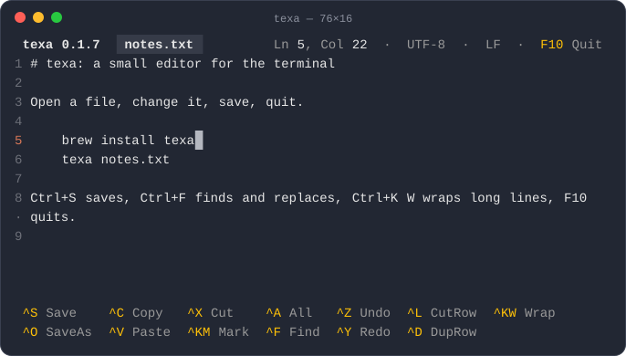
</p>

A small text editor for the **terminal**, in the spirit of nano and vim: open a file, change it,
save, quit.

<table>
<tr>
<td width="50%" align="center" valign="top">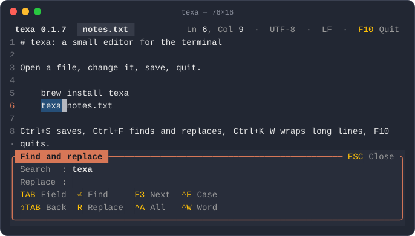<br><sub><b>Find and replace</b> — <code>^F</code>, the panel under the page</sub></td>
<td width="50%" align="center" valign="top">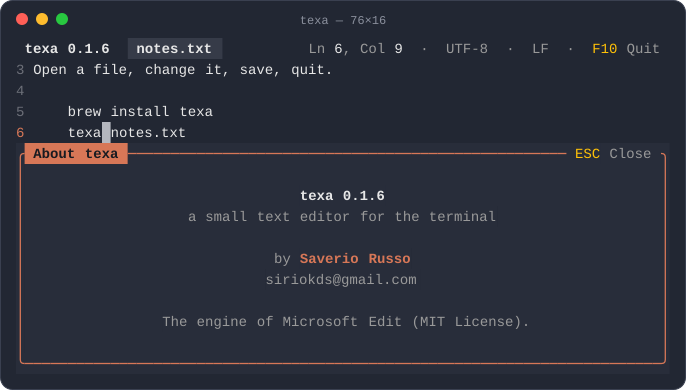<br><sub><b>About</b> — <code>^K A</code></sub></td>
</tr>
</table>

<table>
<tr><td width="150"><b>Find and replace</b></td><td><code>Ctrl+F</code>, as Visual Studio's: <code>F3</code> goes to the next place, replace one or all (one undo takes it back)</td></tr>
<tr><td width="150"><b>Word wrap</b></td><td>long lines go on in the next row; <code>Ctrl+K W</code> switches it</td></tr>
<tr><td width="150"><b>Clipboard</b></td><td>the system's: <code>Ctrl+C</code>, <code>Ctrl+X</code>, <code>Ctrl+V</code></td></tr>
<tr><td width="150"><b>Save As</b></td><td><code>Ctrl+O</code>, with <code>Tab</code> completing the name and a question before writing over a file</td></tr>
<tr><td width="150"><b>Keys in sight</b></td><td>always written at the bottom; they rearrange themselves as the window narrows</td></tr>
</table>

**Install**

```sh
brew install texa
```

**Update** &nbsp;<sub>`brew update` first reads the new versions</sub>

```sh
brew update && brew upgrade texa
```

**Use** &nbsp;—&nbsp; `texa notes.txt` opens a file, `texa` alone an empty page. The version is
beside the name, at the top left; `F10` quits.

<sub>texa uses the engine of Microsoft Edit (MIT License); its notice is installed with the
program (`CREDITS.md`, in `$(brew --prefix)/share/doc/texa`).</sub>

<br>

---

## hexa

<p align="center">
  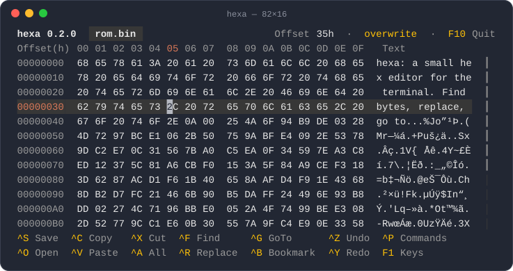
</p>

A **hex editor** for the terminal: a file's bytes and their text side by side, to read, search
and change byte by byte. The same look and keys as texa.

<table>
<tr>
<td width="50%" align="center" valign="top">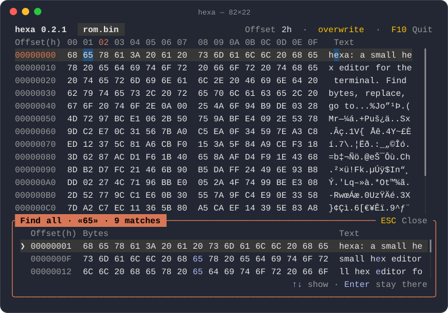<br><sub><b>Find all</b> — every place, under the view</sub></td>
<td width="50%" align="center" valign="top">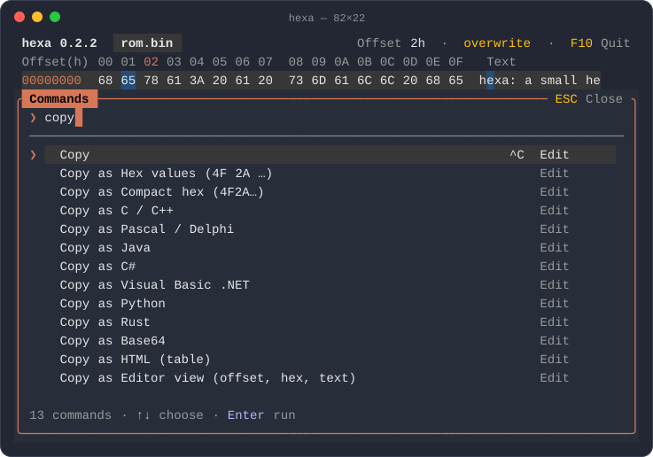<br><sub><b>Every command</b> — <code>^P</code>, filtered as you type</sub></td>
</tr>
</table>

<p align="center">
  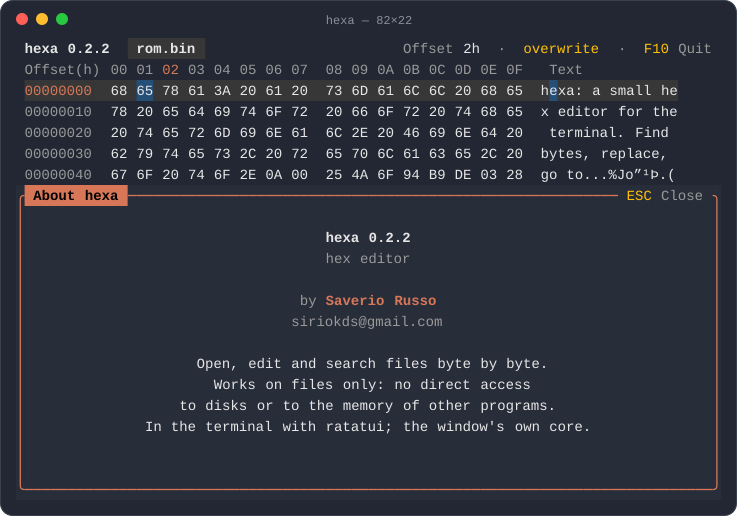<br>
  <sub><b>About</b> — from <code>^P</code></sub>
</p>

<table>
<tr><td width="150"><b>Find and replace</b></td><td><code>^F</code> bytes, text or numbers; <code>??</code> is any byte, <code>*</code> 0 to 16 bytes (<code>DE AD * BE EF</code>); Find all lists every place; <code>^R</code> replaces</td></tr>
<tr><td width="150"><b>Go to, select, fill</b></td><td><code>^G</code> an offset, hex or decimal; select a block, fill it, insert or write bytes: each form says what it will do while you type</td></tr>
<tr><td width="150"><b>Checksums, statistics</b></td><td>CRC, MD5, SHA and more, of the file or the selection (Enter copies the value); the 256 byte values as a chart, with the entropy</td></tr>
<tr><td width="150"><b>Every command</b></td><td><code>^P</code> finds any command by typing; <code>F1</code> lists the keys</td></tr>
<tr><td width="150"><b>More files</b></td><td>several files open as tabs (<code>F6</code> the next one); the text in ANSI, Latin-1, ASCII, Mac Roman, DOS 437 or EBCDIC</td></tr>
</table>

**Install**

```sh
brew install hexa
```

**Update** &nbsp;<sub>`brew update` first reads the new versions</sub>

```sh
brew update && brew upgrade hexa
```

**Use** &nbsp;—&nbsp; `hexa file.bin` opens a file, `hexa` alone shows the recent ones. The
version is beside the name, at the top left; `F10` quits.

<br>

---

## SparkEdit

<p align="center">
  
</p>

A text editor for the **Mac** whose tabs are miniatures of their pages. Beside each name, in
red, a few words on what the document contains: the Mac writes them by itself. macOS 14 or
later.

**New in 2.1: colours for code.** 22 languages (Bash, C, C#, C++, CMake, CSS, Dockerfile, HTML,
JavaScript, JSON, JSX, Lua, Make, Markdown, PHP, Python, Rust, SQL, TOML, TSX, TypeScript, and Z80
assembly for sjasmplus from the plugin's 1.2), in the colours of the theme. The language is written
at the bottom right; a click there, or the **Language** menu, changes it for that document.

<p align="center">
  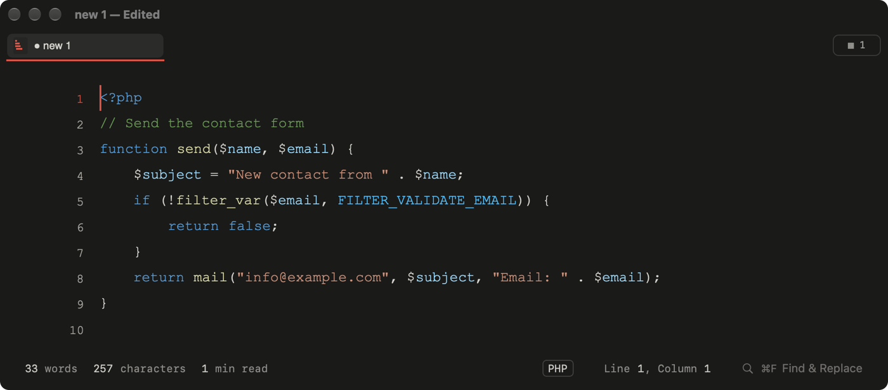
</p>

- **Recognised by itself**: a file by its name (`.php`, `Makefile`, `Dockerfile`); a new document
  by its first line (`#!/bin/bash`, `<?php`, `<!DOCTYPE html>`); and, with Apple Intelligence, a
  new document of code by what it contains, once, when it is in front of you.
- **Chosen by hand** when you want: the Language menu has Automatic, Plain Text and the
  languages by letter; a choice made on a file is remembered for it.
- **When the colour comes** (Settings › Text): *Relaxed*, when you stop; *Normal*, in the small
  pauses; *Quick*, as you type. A change of language fades in, never pops.
- The colours come from the **dual-syntax** plugin, optional: without it SparkEdit is as before
  (see Install).

**The tabs follow how many documents are open** (up to 128):

<table>
<tr><td align="center"><sub><b>a few documents</b> — the names</sub><br>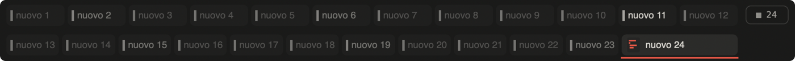</td></tr>
<tr><td align="center"><sub><b>more</b> — the names shorten, the number stays</sub><br></td></tr>
<tr><td align="center"><sub><b>many</b> — each tab is a miniature of its page</sub><br></td></tr>
<tr><td align="center"><sub><b>a hundred and more</b> — bars, as tall as their text is long</sub><br>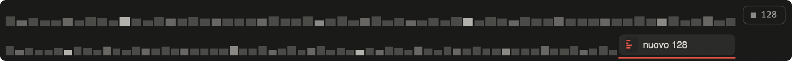</td></tr>
</table>

**All Pages** (`⌘.`) — every document as a page, with its first lines and what it contains;
type, and only the pages with those words stay.

<p align="center">
  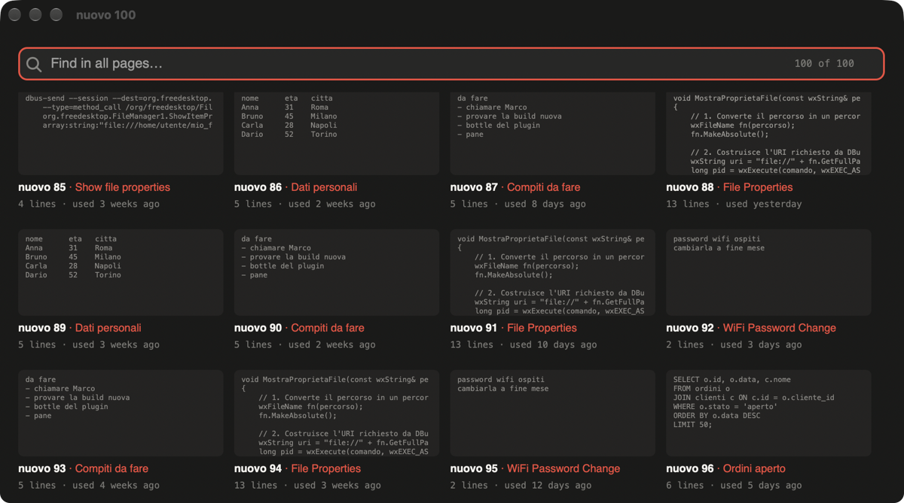
</p>

**Settings** (`⌘,`) — every choice is a small picture of what it does. Nothing to confirm: what
you choose is seen at once on the whole app, and kept.

<table>
<tr>
<td width="50%" align="center" valign="top">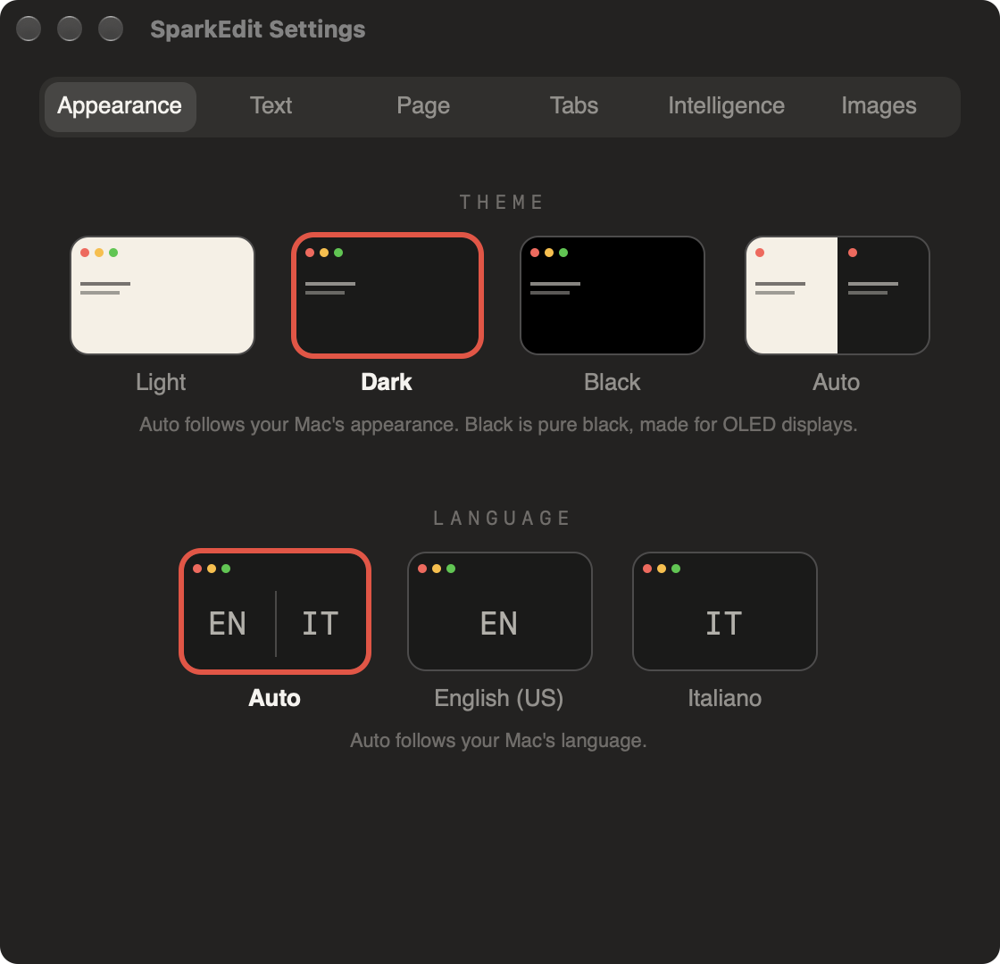<br><sub><b>Appearance</b> — Light, Dark, Black or Auto (as the Mac); English or Italian, or as the Mac</sub></td>
<td width="50%" align="center" valign="top">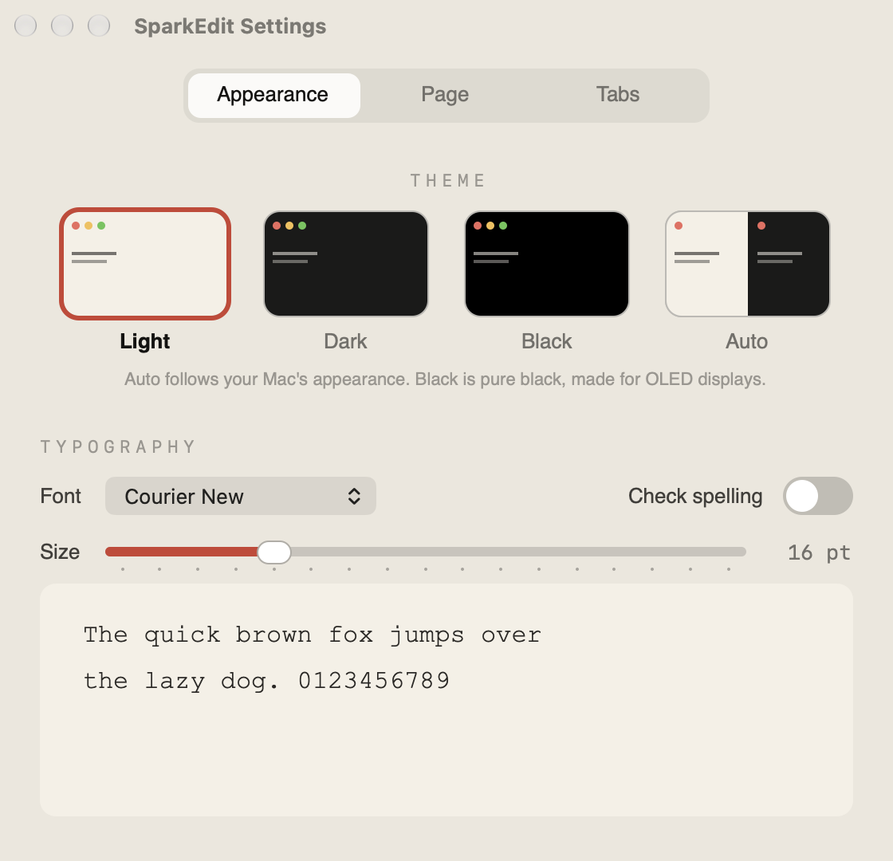<br><sub><b>Light</b> — the page as paper; the theme reaches every part at once</sub></td>
</tr>
<tr>
<td width="50%" align="center" valign="top">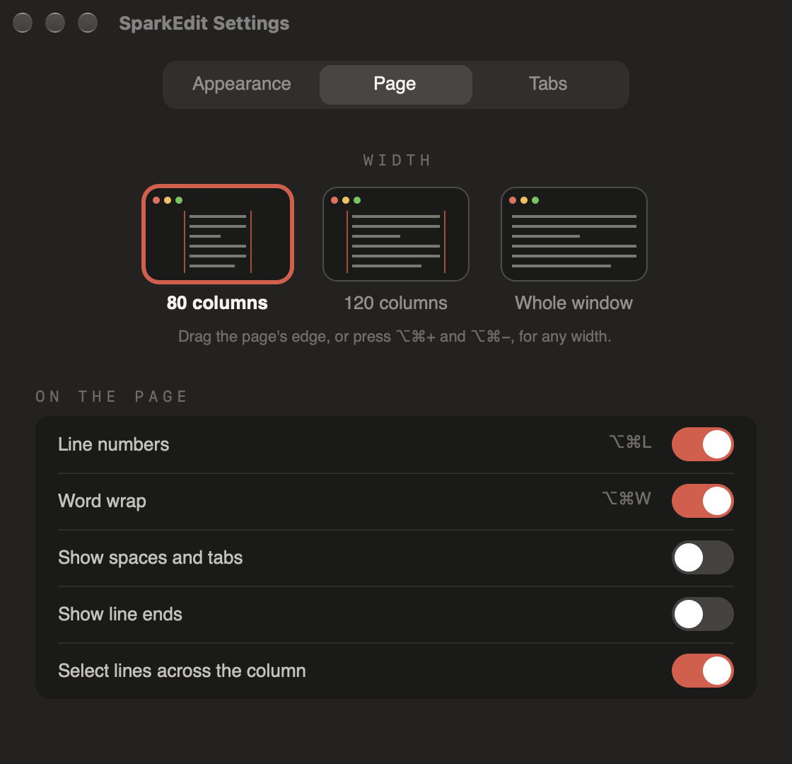<br><sub><b>Page</b> — 80 columns, 120 or the whole window; line numbers, word wrap, spaces, line ends</sub></td>
<td width="50%" align="center" valign="top">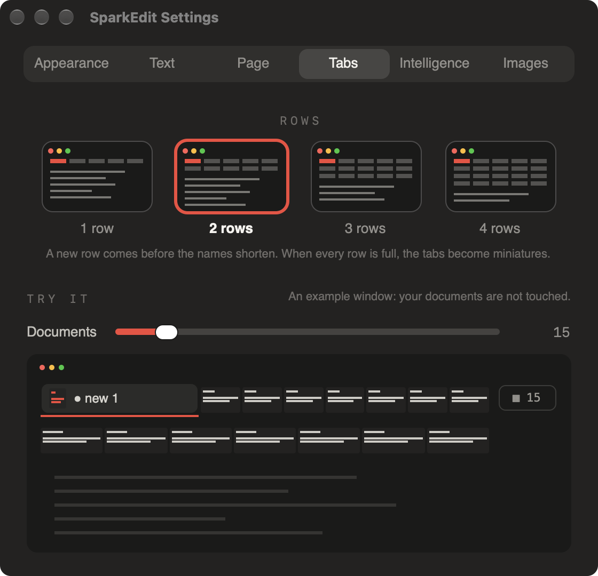<br><sub><b>Tabs</b> — one to four rows, tried on your own documents in a small example window</sub></td>
</tr>
<tr>
<td width="50%" align="center" valign="top">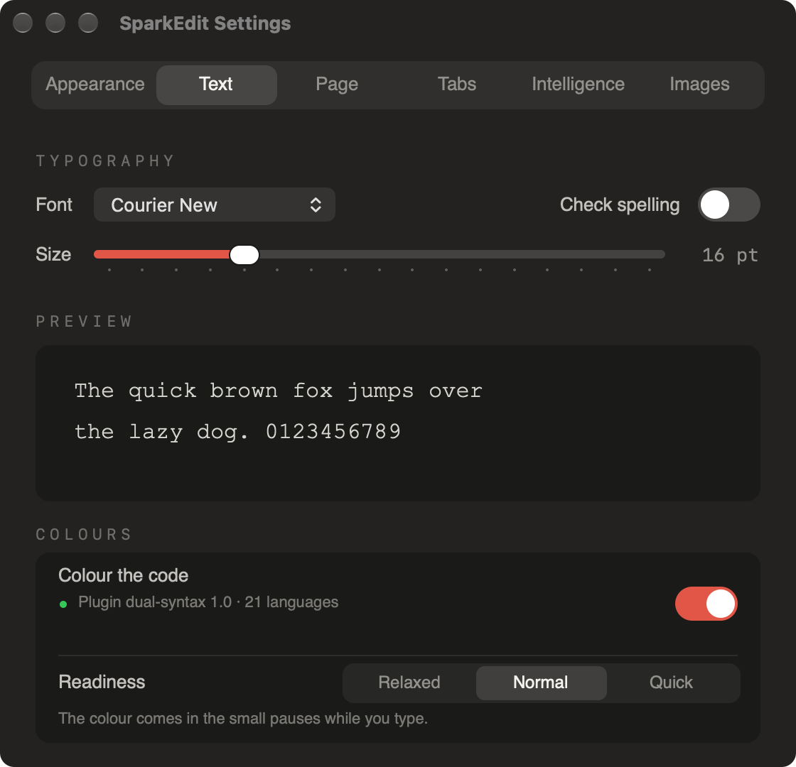<br><sub><b>Text</b> — the font, the size, Check spelling; Colour the code and when the colour comes</sub></td>
<td width="50%" align="center" valign="top">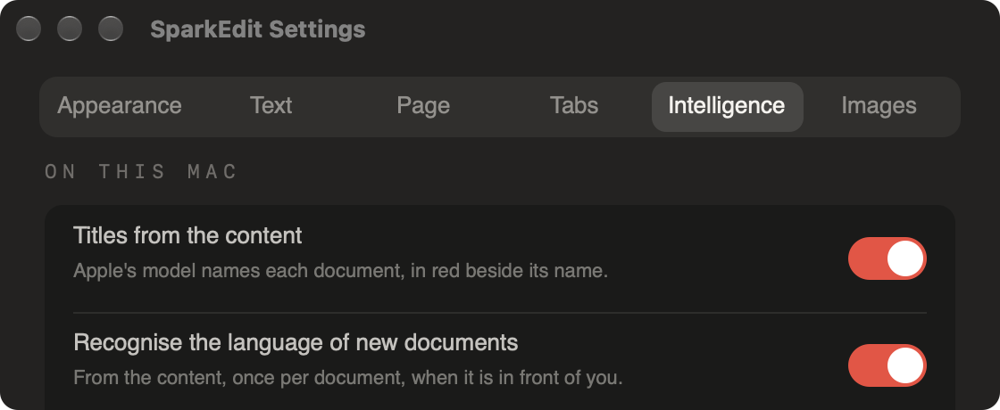<br><sub><b>Intelligence</b> — titles, and the language of new documents, by Apple's on-device model</sub></td>
</tr>
</table>

<table>
<tr><td width="150"><b>Settings</b></td><td><code>⌘,</code>: themes (Light as paper, Dark, Black, Auto), font and size, the page's width and what it shows, the rows of tabs, the colours for code</td></tr>
<tr><td width="150"><b>Colours for code</b></td><td>22 languages with the optional dual-syntax plugin, Z80 assembly among them (sjasmplus); the Language menu and the status line; recognised by name, by the first line, or by Apple's model for new documents</td></tr>
<tr><td width="150"><b>Check spelling</b></td><td>the Mac's own, a red wave under the words: only once you stop typing, never on the word you are writing</td></tr>
<tr><td width="150"><b>Titles by themselves</b></td><td>a few words on what each document contains, beside its name: written on the Mac by Apple's on-device model (Apple Intelligence, macOS 26 or later), with nothing to ask for</td></tr>
<tr><td width="150"><b>All Pages</b></td><td><code>⌘.</code> shows every document as a page, filtered by what it contains</td></tr>
<tr><td width="150"><b>Session</b></td><td>every document comes back at the next start, the ones never saved too</td></tr>
<tr><td width="150"><b>Find & Replace</b></td><td><code>⌘F</code> and <code>⌘H</code>, with regular expressions; Replace All is one undo</td></tr>
<tr><td width="150"><b>Big files</b></td><td>a file of megabytes has its tab at once and fills in while you look</td></tr>
<tr><td width="150"><b>From the shell</b></td><td><code>spk notes.txt</code> opens the file here, as CotEditor's <code>cot</code></td></tr>
</table>

**Install**

```sh
brew install --cask sparkedit
```

<sub>Without Homebrew: the DMG of the latest SparkEdit in [Releases](https://github.com/siriokds/homebrew-tap/releases); drag SparkEdit to Applications.</sub>

> [!IMPORTANT]
> **The first time only.** SparkEdit is not notarized by Apple, so macOS stops it:
> 1. open SparkEdit from Applications and close macOS's message;
> 2. open **System Settings › Privacy & Security** and click **Open Anyway**.
>
> From then on it opens as any app, and `spk` works (until then macOS stops `spk` too).

**Colours for code** &nbsp;<sub>optional: the dual-syntax plugin, from Dual's plugins tap; Settings › Text says whether SparkEdit found it</sub>

```sh
brew install siriokds/dual-viewers/dual-syntax
```

<sub>Already installed? `brew update && brew upgrade dual-syntax` brings the new languages (1.2: Z80 assembly).</sub>

**Update** &nbsp;<sub>`brew update` first reads the new versions; Homebrew closes SparkEdit if it is open</sub>

```sh
brew update && brew upgrade --cask sparkedit
```

<sub>If macOS stops SparkEdit after an update, **Open Anyway** again as the first time.</sub>

**Use** &nbsp;—&nbsp; `spk notes.txt` opens the file in SparkEdit, starting it if it is not
running; a file that does not exist yet is made, empty. `spk -h` tells the rest.

<br>

---

<details>
<summary><b>Installed from the old taps</b> (<code>siriokds/texa</code>, <code>siriokds/sparkedit</code>)?</summary>

<br>

Both programs are here now. Move them once (SparkEdit's notes and settings are not touched):

```sh
brew uninstall texa && brew uninstall --cask sparkedit
brew untap siriokds/texa siriokds/sparkedit
brew tap siriokds/tap && brew trust siriokds/tap
brew install texa && brew install --cask sparkedit
```

</details>
