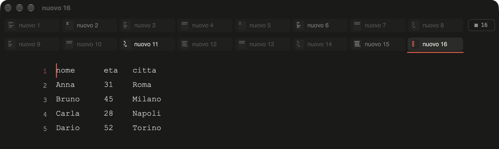

<div align="center">

# siriokds · Homebrew tap

**Two small text editors for the Mac, ready to install with Homebrew.**

[texa](#texa) · [SparkEdit](#sparkedit) · [Updates](#updates)

<sub>Mac with Apple silicon · built programs, nothing to compile</sub>

</div>

---

## texa

A text editor for the **terminal**, in the spirit of nano and vim: open a file, change it, save,
quit.

**Install** — copy, paste in Terminal:

```sh
brew install siriokds/tap/texa
```

**Use:** `texa notes.txt` opens a file; `texa` alone opens an empty page. The keys are written at
the bottom of the screen; F10 quits.

<sub>texa uses the engine of Microsoft Edit (MIT License); its notice is installed with the
program (`CREDITS.md`, in `$(brew --prefix)/share/doc/texa`).</sub>

---

## SparkEdit

A text editor for the **Mac**, whose tabs are miniatures of their pages, with the `spk` command
to open files from the shell.

<p align="center"></p>

**Install** — copy, paste in Terminal:

```sh
brew install --cask siriokds/tap/sparkedit
```

> [!IMPORTANT]
> **The first time only.** SparkEdit is not notarized by Apple, so macOS stops it:
> 1. open SparkEdit from Applications and close macOS's message;
> 2. open **System Settings › Privacy & Security** and click **Open Anyway**.
>
> From then on it opens as any app, and `spk` works (until then macOS stops `spk` too).

**Use:** `spk notes.txt` opens the file in SparkEdit, starting it if it is not running; a file
that does not exist yet is made, empty. `spk -h` tells the rest. macOS 14 or later.

---

## Updates

```sh
brew update && brew upgrade
```

`brew update` first, so that Homebrew reads the new versions.

> [!NOTE]
> The first installation needs the whole name (`siriokds/tap/…`): Homebrew loads programs from a
> tap that is not its own only when they are named in full, and from then on trusts them.

<details>
<summary><b>Installed from the old taps</b> (<code>siriokds/texa</code>, <code>siriokds/sparkedit</code>)?</summary>

<br>

Both programs are here now. Move them once (SparkEdit's notes and settings are not touched):

```sh
brew uninstall texa && brew install siriokds/tap/texa
brew uninstall --cask sparkedit && brew install --cask siriokds/tap/sparkedit
brew untap siriokds/texa siriokds/sparkedit
```

</details>
